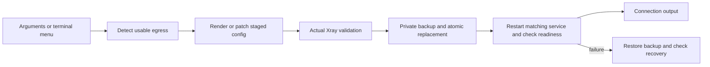

# Installer architecture

`nokey.sh` owns Xray installation, REALITY template generation and focused configuration patches. Feature entrypoints cover Realm, SOCKS, WARP, BBR, ACME and Hysteria2. Shared terminal/logging functions live in `nokey-common.sh`; machine-readable helper stdout must remain free of UI messages.

Fresh Reality installs also include an IPv6-bound Shadowsocks 2022 inbound when a local global IPv6 address exists. Both inbounds use the same Xray service and staged validation/rollback path. Without that address, the generated config contains only the Reality inbound (plus any explicitly requested SOCKS inbound).

## Configuration flow

Egress selection is independent of the server address advertised to clients. `--netstack` selects the latter; `--default-route` chooses preferred egress. The first Freedom outbound carries the default policy. Explicit `force_ipv4`, `force_ipv6`, WARP and block tags retain their routing purpose. TCP Happy Eyeballs applies to unresolved domain targets; UDP and literal IPs have different semantics.

Global DNS `UseIP` keeps A and AAAA on a reachable dual-stack host. A single-stack host restricts queries to that family. Resolver transport addresses are ordered by preference; existing split DNS objects and unrelated DNS settings survive patches. An incompatible custom proxy, bind or ambiguous default policy is rejected.

## Diagnostics and sensitive output

Terminal output uses complete progress/status lines and terminal-only colors. Diagnostic logs have timestamps, level, run ID, phase, command outcome and duration. `NOKEY_LOG_LEVEL` controls filtering. Output initialization sanitizes legacy diagnostic history and retains a bounded previous log. Sensitive connection details go to stdout and a 0600 share file, never to diagnostic logs. Private keys are not printed.

Xray runtime output remains with systemd journal or the existing OpenRC service configuration. Failed restarts collect bounded service diagnostics. Conventional `/usr/local/etc/xray/config.json` maps to `xray.service`/`xray`; the NoKey path maps to `nokey.service`/`nokey`.

The YAML trial renders new NoKey configs at `/usr/local/etc/nokey/nokey.yaml`, which Xray reads directly. Existing JSON installs keep their path and format. jq-based patch modes use a temporary JSON view for YAML inputs, then serialize the final staged result back to YAML before Xray validation and atomic replacement. A matching Mike Farah `yq` is reused; otherwise the pinned v4.54.1 binary is downloaded to NoKey's private tool directory and verified against a fixed SHA-256 before use. The private tool directory is added to the installer's PATH and to existing Bash/Zsh rc files for future shells. A patch rewrites YAML formatting and comments.

Binary downloads are staged, executable/version checked and atomically renamed. Config rollback restores configuration; it is not a full binary or OS rollback. A new install with no previous config reports that recovery boundary explicitly.
